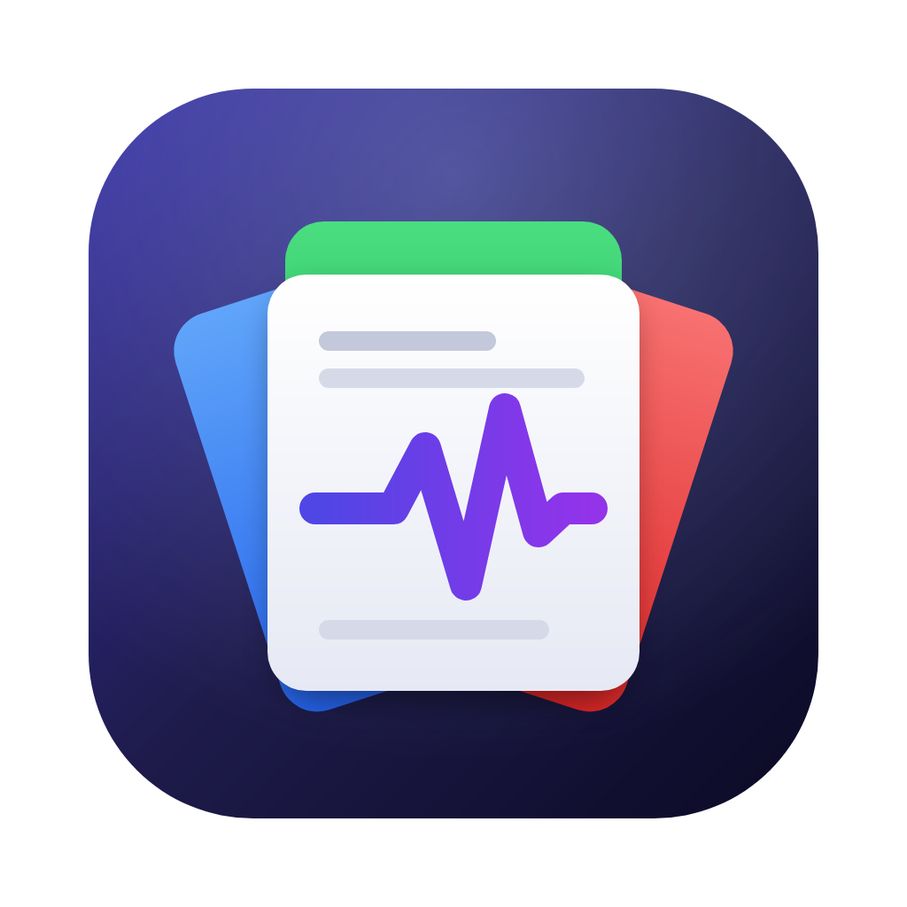

<p align="center">
  
</p>

<h1 align="center">PulseOffice</h1>

<p align="center">A cross-platform office suite for macOS, Windows and Linux.<br>
Developed with the help of AI (<a href="https://claude.com/claude-code">Claude Code</a>).<br>
<a href="https://pulseoffice.github.io/">Website</a></p>

---

> **Work in progress.** PulseOffice is still under active development: expect missing pieces, rough edges and
> breaking changes, and keep backups of important documents.

## The suite

| Module | For | |
|---|---|---|
| **Folio** | word processing | ODT, DOCX, RTF, HTML, text, PDF export |
| **Ledger** | spreadsheets | ODS, XLSX, CSV; the full set of 432 spreadsheet functions, pivot tables, charts, external data |
| **Deck** | presentations | ODP, PPTX; layouts, transitions and animations of the major suites, video export |

- **ODF first, OOXML aligned**: every feature crosses both formats, or the loss is declared when saving.
- **Shared core**: charts, images, shapes and tables move between the three modules through one exchange layer.
- **Macros** in JavaScript and Python with an integrated editor, sandboxed by default.
- **AI agent ready**: a built-in MCP server (Model Context Protocol, an open standard) lets any MCP-compatible agent read
  and edit open documents, over local HTTP or through a stdio bridge (off by default, every change undoable). See
  [docs/agent-plan.md](docs/agent-plan.md).
- **Security**: digital signatures (ODF, OOXML, PDF), password and OpenPGP encryption, sheet and document protection.
- **Automatic updates**: checks GitHub once a day, downloads and verifies signed packages, installs on restart (macOS,
  Windows and Linux AppImage).
- **Five interface languages**: English, Italian, German, Spanish, French.

Built with .NET 10 and Avalonia 12.

## Build and run

Requires the .NET 10 SDK.

```bash
dotnet build PulseOffice.slnx
dotnet test PulseOffice.slnx
dotnet run --project src/PulseOffice.Desktop
```

## Packaging with `pulse-cmd.py`

`pulse-cmd.py` bumps the version and builds the installers. Run it without arguments for an interactive menu, or
with a command:

| Command | What it does |
|---|---|
| `version` | Shows the current version (`<Version>` in `Directory.Build.props`) |
| `bump [major\|minor\|patch]` | Bumps the version; `--set 1.2.0` sets it explicitly, `--git` commits and tags it |
| `mac [--arch arm64\|x64\|all]` | Signed `.dmg` images, notarized by Apple unless `--no-notarize` |
| `windows [--arch x64\|arm64\|all]` | NSIS installer in the five languages, with the license page |
| `linux [--arch x86_64\|aarch64\|all]` | AppImage, built in Docker |
| `all [--release] [--force]` | All of the above; `--release` then publishes them; `--force` answers yes to every confirmation |
| `update-key` | Creates, once, the key that signs update checksums; the public key goes in `src/PulseOffice.Updates/Trust/` |
| `release [--notes FILE] [--draft] [--prerelease] [--force]` | Publishes a GitHub release `vX.Y.Z` with the packages of the current version attached |

Output goes to `artifacts/` (not versioned).

`release` also writes `SHA256SUMS` and signs it (`SHA256SUMS.sig`): the app installs updates only when this signature
and the package checksum match. It uses the GitHub CLI (`gh`, already logged in). If the tag is not on GitHub yet it offers to commit the
version, tag it and push; notes are generated from the commits unless a file is given. It lists the files and asks
for confirmation before publishing.

What each target needs:

- **macOS**: Xcode command-line tools and a *Developer ID Application* certificate in the keychain. The first
  notarization asks for your Apple ID, Team ID and an app-specific password and stores them in a keychain profile:
  no credential is ever written to the repository.
- **Windows**: `makensis` (NSIS) on the `PATH`; the installer is built from macOS or Linux too.
- **Linux**: Docker; the AppImage is built in a `debian:bookworm-slim` container with `appimagetool`. It needs the
  system's ICU library (`libicu`), present on desktop distributions.

## Documentation

- [CLAUDE.md](CLAUDE.md): decisions, working rules and open points
- [docs/architecture.md](docs/architecture.md): solution structure and critical subsystems
- [docs/worklog.md](docs/worklog.md): history of the work, with defects and verifications

## License

[GPL-3.0-only](LICENSE). The bundled autocorrect lists are under MPL 2.0 (see their `NOTICE`).
